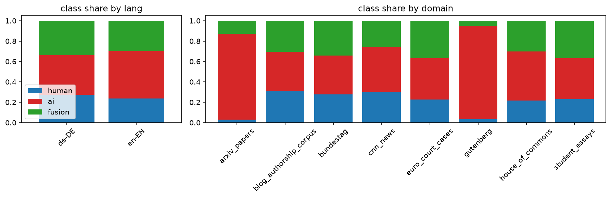
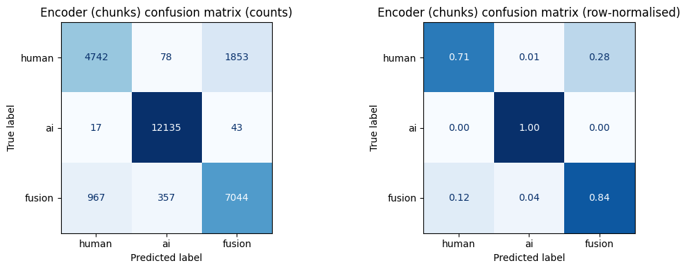
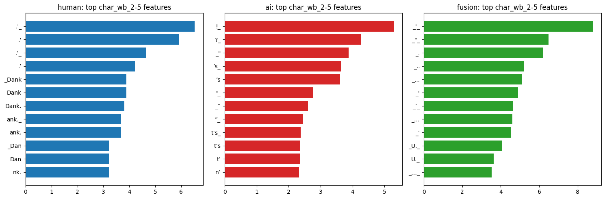

<!--
TEMPLATE.
Limit: 1–2 pages of text; tables and figures can go to the appendix.
Required by the brief: methodology, results incl. failed attempts, final model + run instructions,
names of the selected Kaggle submission files.
-->

## Introduction

The task is to label a text as `human`, `ai` (generated by an LLM) or `fusion` (a human text partly rewritten by an LLM).\
Data: 272,352 train and 25,000 test texts in English and German from 8 domains.\
Metric: macro-F1, so the hardest class, `fusion`, weighs as much as the others.

I compare a TF-IDF baseline, a fine-tuned multilingual encoder and further experiments on one fixed validation split.

## Data and EDA

Code: [`01_eda.ipynb`](https://github.com/mohinska/ai_hw3_AIGenTextDetection/blob/main/notebooks/01_eda.ipynb)

| Split | Texts | Labels |
|---|---:|---|
| train | 272,352 | human / ai / fusion |
| test | 25,000 | no |

| Language | human | ai | fusion | Total |
|---|---:|---:|---:|---:|
| en | 52,220 (23.8%) | 101,603 (46.3%) | 65,758 (29.9%) | 219,581 |
| de | 14,510 (27.5%) | 20,337 (38.5%) | 17,924 (34.0%) | 52,771 |
| all | 66,730 (24.5%) | 121,940 (44.8%) | 83,682 (30.7%) | 272,352 |

Findings and what follows from them:

- **Imbalance:** ai 44.8%, human 24.5% -> class weights / threshold tuning.
- **Language = domain:** German is only bundestag (+428 gutenberg) -> no language feature; split stratified by label + language.
- **Domain shortcuts:** arxiv 84% ai, gutenberg 92% ai; in arxiv ai texts are ~3x shorter -> check F1 per domain.
- **Test shift:** gutenberg 2.7% -> 7.4%, German 19.4% -> 14.7% -> val may differ from LB.
- **Long texts:** 64% over 512 tokens (German up to 92%) -> chunking for the encoder.
- **AI style:** longer words, more even sentences; fusion is in between, closer to human, keeps human typos -> fusion is the hardest class, mostly confused with human.
- **Artifacts:** English fragments in 2% of German ai texts, PDF ligatures in English fusion -> easy signal for char n-grams.

## Validation

The validation split is 10% of `train.csv` (27,236 texts), stratified by label and language with seed 42 ([`split_train_val`](https://github.com/mohinska/ai_hw3_AIGenTextDetection/blob/main/src/common.py)). Parameters tuned on validation in `05` (ensemble weights, class scaling) are chosen on one half of it and scored on the other, so their scores stay comparable with untuned models.

## Baseline

Code: [`02_baseline_tfidf.ipynb`](https://github.com/mohinska/ai_hw3_AIGenTextDetection/blob/main/notebooks/02_baseline_tfidf.ipynb)

| Features | C | Val macro-F1 |
|---|---:|---:|
| word 1-2 | 8.0 | 0.8467 |
| char_wb 2-5 | 2.0 | **0.8724** |
| word + char | 2.0 | 0.8723 |

Character n-grams carry most of the signal: `char_wb_2-5` reaches 0.8724, words alone 0.8467, and combining both adds nothing. The model separates `ai` almost perfectly (F1 0.984); nearly all errors are between `human` and `fusion` (18% of `fusion` predicted as `human`, 15% the other way). The weakest domains are `blog_authorship_corpus` (0.75) and `gutenberg` (0.80). Public LB 0.86898 is close to validation, so the split is a reliable proxy.

## Encoder

Code: [`03_encoder.ipynb`](https://github.com/mohinska/ai_hw3_AIGenTextDetection/blob/main/notebooks/03_encoder.ipynb)

| Model | Long texts | Val macro-F1 | F1 human | F1 ai | F1 fusion |
|---|---|---:|---:|---:|---:|
| XLM-R base | truncate (first 512 tokens) | 0.8353 | 0.7489 | 0.9848 | 0.7721 |
| XLM-R base | chunks ([`chunk_ids`](https://github.com/mohinska/ai_hw3_AIGenTextDetection/blob/main/src/features.py), averaged) | **0.8530** | 0.7649 | 0.9800 | 0.8140 |
| TF-IDF baseline | full text | 0.8724 | 0.8092 | 0.9843 | 0.8238 |

`xlm-roberta-base` was fine-tuned for one epoch on 40k texts (first 512 tokens, 21 min on a T4). Reading the whole text in 512-token chunks and averaging the probabilities beats truncation by 0.018, with the largest gains on long-text domains (`gutenberg` +0.09, `euro_court_cases` +0.04). The encoder still trails the TF-IDF baseline (0.853 vs 0.872, LB 0.848); the training loss was still falling, so it is undertrained. It collapses on `arxiv_papers` (0.47 vs 0.85), probably because it cannot see text length, which separates `ai` there. Its errors differ from the baseline: it confuses `human` as `fusion` (recall 0.71), while the baseline does the opposite, and it is better on `student_essays` and `blog_authorship_corpus`. This makes it useful in an ensemble.

## Experiments

Reference for 04: the baseline config (`char_wb_2-5`, `C=2`, same 60k texts). Reference for 05: the best single model on val.

| Experiment | Notebook | Val macro-F1 | Delta vs reference |
|---|---|---:|---:|
| `class_weight="balanced"` | [`04`](https://github.com/mohinska/ai_hw3_AIGenTextDetection/blob/main/notebooks/04_experiments_tfidf.ipynb) | 0.8725 | +0.0001 |
| + one-hot `domain` | `04` | 0.8700 | -0.0025 |
| + stylometry ([`style_features`](https://github.com/mohinska/ai_hw3_AIGenTextDetection/blob/main/src/features.py)) | `04` | 0.8694 | -0.0031 |
| all three | `04` | 0.8702 | -0.0022 |
| ensemble of models | [`05`](https://github.com/mohinska/ai_hw3_AIGenTextDetection/blob/main/notebooks/05_ensemble_thresholds.ipynb) |  |  |
| per-class scaling | `05` |  |  |
| ensemble + scaling | `05` |  |  |

On top of TF-IDF nothing helped. Balanced class weights only move errors from `human` to `fusion` (val +0.0001, LB 0.86989 vs 0.86898). One-hot `domain` and stylometric features make the model slightly worse (-0.0025 and -0.0031): character n-grams already encode the domain and the style, and the extra dense features add noise while making training 4x slower. The linear model is saturated, so the remaining gains have to come from combining it with the encoder.

<!-- TODO: conclusions after 05 -->

## Results

| Model | Setup | Val macro-F1 | F1 human | F1 ai | F1 fusion | Public LB |
|---|---|---:|---:|---:|---:|---:|
| TF-IDF + LogReg (baseline) | char_wb 2-5, C=2, 60k train | 0.8724 | 0.8092 | 0.9843 | 0.8238 | 0.86898 |
| XLM-R base, chunks | 40k train, 1 epoch | 0.8530 | 0.7649 | 0.9800 | 0.8140 | 0.84822 |
| TF-IDF + `class_weight` | char_wb 2-5, C=2, balanced | 0.8725 | 0.8132 | 0.9845 | 0.8198 | 0.86989 |
| <!-- experiment 2 --> |  |  |  |  |  |  |
| <!-- final --> |  |  |  |  |  |  |

## Bonus: explainability

Code: [`06_xai.ipynb`](https://github.com/mohinska/ai_hw3_AIGenTextDetection/blob/main/notebooks/06_xai.ipynb)

<!-- TODO: conclusions after 06 -->

<!--  -->

## Final model and reproducibility

<!-- TODO: final model in 1–2 sentences. -->

Selected Kaggle submissions:

| File | Model | Val macro-F1 | Public LB |
|---|---|---:|---:|
| <!-- submission_....csv --> |  |  |  |
| <!-- submission_....csv --> |  |  |  |

Run: all notebooks except `01` run on Kaggle (competition data attached, Internet on); each clones this repository and imports [`src/`](https://github.com/mohinska/ai_hw3_AIGenTextDetection/blob/main/src). Seed 42.

| Order | Notebook | Accelerator | Extra inputs |
|---|---|---|---|
| 1 | [`02_baseline_tfidf`](https://github.com/mohinska/ai_hw3_AIGenTextDetection/blob/main/notebooks/02_baseline_tfidf.ipynb) | CPU | - |
| 2 | [`03_encoder`](https://github.com/mohinska/ai_hw3_AIGenTextDetection/blob/main/notebooks/03_encoder.ipynb) | GPU T4 | output of `02` |
| 2 | [`04_experiments_tfidf`](https://github.com/mohinska/ai_hw3_AIGenTextDetection/blob/main/notebooks/04_experiments_tfidf.ipynb) | CPU | - |
| 2 | [`06_xai`](https://github.com/mohinska/ai_hw3_AIGenTextDetection/blob/main/notebooks/06_xai.ipynb) | CPU | - |
| 3 | [`05_ensemble_thresholds`](https://github.com/mohinska/ai_hw3_AIGenTextDetection/blob/main/notebooks/05_ensemble_thresholds.ipynb) | CPU | outputs of `02`, `03`, `04` |

`01_eda` runs locally with the data in `data/`.

## Conclusion

<!-- TODO -->

AI usage: <!-- TODO: what AI was used for (code only). -->

## References

- XLM-R: Conneau et al., "Unsupervised Cross-lingual Representation Learning at Scale", ACL 2020; weights `xlm-roberta-base` from Hugging Face
- Hugging Face Transformers, PyTorch
- scikit-learn (TF-IDF, logistic regression, metrics)

## Appendix

<!-- Tables and figures that do not fit in 2 pages. -->
