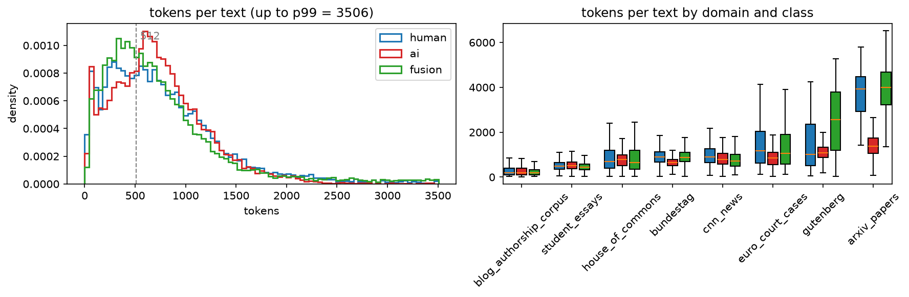
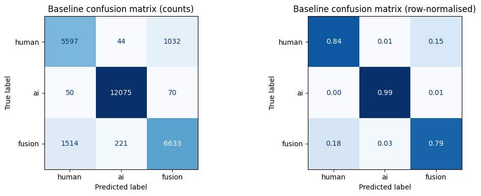

<!--
TEMPLATE. All prose below must be written by you (AI is not allowed for the report text).
Limit: 1–2 pages of text; tables and figures can go to the appendix.
Required by the brief: methodology, results incl. failed attempts, final model + run instructions,
names of the selected Kaggle submission files.
-->

## Introduction

<!-- TODO: task in 2–3 sentences (human / ai / fusion, EN + DE, macro-F1) and what you compare. -->

## Data and EDA

Code: [01_eda.ipynb](https://github.com/mohinska/ai_hw3_AIGenTextDetection/blob/main/notebooks/01_eda.ipynb) <!-- TODO: fix the link when the EDA notebook exists -->

| Split | Texts | Labels |
|---|---:|---|
| train | 272,352 | human / ai / fusion |
| test | 25,000 | no |

| Language | human | ai | fusion | Total |
|---|---:|---:|---:|---:|
| en |  |  |  |  |
| de |  |  |  |  |

<!-- TODO: findings → decisions (class balance by language and domain, text lengths, examples of each class).
     Answer explicitly: what makes fusion different? -->

- <!-- finding --> $\rightarrow$ <!-- decision -->

<!--  -->

## Validation

<!-- TODO: describe the split in your words.
     Facts from the code (src/common.py, split_train_val): 10% of train.csv, stratified by label + language,
     seed 42, the same split for every model; vectorizers / tokenizers fitted on the train part only. -->

## Baseline

Code: [02_baseline_tfidf.ipynb](https://github.com/mohinska/ai_hw3_AIGenTextDetection/blob/main/notebooks/02_baseline_tfidf.ipynb)

| Features | C | Val macro-F1 |
|---|---:|---:|
| word 1-2 |  |  |
| char_wb 2-5 |  |  |
| word + char |  |  |

<!-- TODO: parameter search, per-class metrics, confusion matrix: what is confused with what. -->

<!--  -->

## Encoder

<!-- TODO: backbone, max length and how texts longer than it are handled, training setup,
     comparison with the baseline on the same split. -->

## Experiments

<!-- TODO: at least two experiments, each compared with a fixed reference (name it). -->

### Experiment 1: <!-- name -->

### Experiment 2: <!-- name -->

Unsuccessful attempts: <!-- TODO -->

## Results

| Model | Setup | Val macro-F1 | F1 human | F1 ai | F1 fusion | Public LB |
|---|---|---:|---:|---:|---:|---:|
| TF-IDF + LogReg (baseline) |  |  |  |  |  |  |
| <!-- encoder --> |  |  |  |  |  |  |
| <!-- experiment 1 --> |  |  |  |  |  |  |
| <!-- experiment 2 --> |  |  |  |  |  |  |
| <!-- final --> |  |  |  |  |  |  |

## Bonus: explainability

<!-- TODO: method (SHAP / LIME / token attributions), what the model relies on, conclusions. -->

## Final model and reproducibility

<!-- TODO: final model in 1–2 sentences. -->

Selected Kaggle submissions:

| File | Model | Val macro-F1 | Public LB |
|---|---|---:|---:|
| <!-- submission_....csv --> |  |  |  |
| <!-- submission_....csv --> |  |  |  |

Run: notebooks run on Kaggle (competition data attached as input, Internet on), clone this repository and import the shared code from [src/common.py](https://github.com/mohinska/ai_hw3_AIGenTextDetection/blob/main/src/common.py); packages: [requirements.txt](https://github.com/mohinska/ai_hw3_AIGenTextDetection/blob/main/requirements.txt); seed 42. <!-- TODO: order of notebooks, GPU, approximate run time. -->

## Conclusion

<!-- TODO -->

AI usage: <!-- TODO: what AI was used for (code only). -->

## References

<!-- TODO: models, papers and code used, e.g. XLM-R, mDeBERTa, scikit-learn, Hugging Face Transformers. -->

## Appendix

<!-- Tables and figures that do not fit in 2 pages. -->
